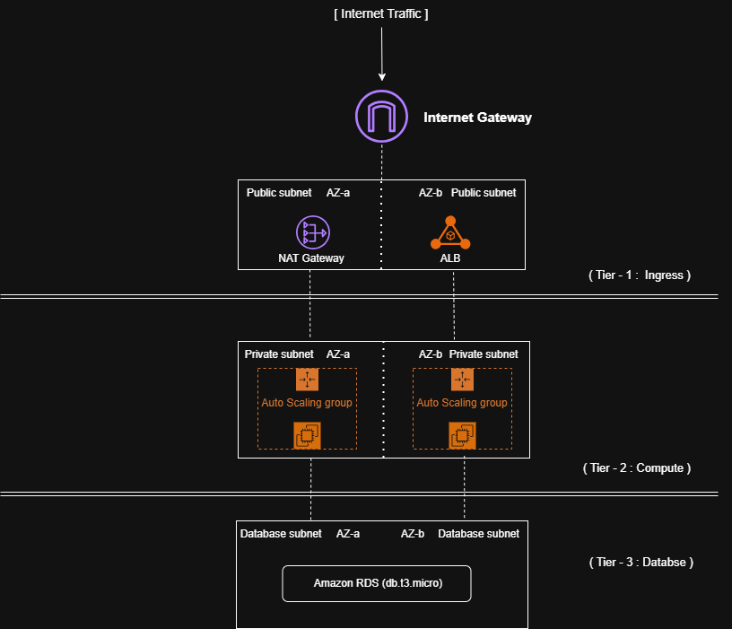

# AWS Highly Available 3-Tier Architecture

## Overview
A production-ready, fault-tolerant 3-tier web application architecture provisioned entirely through Infrastructure as Code (IaC). This project demonstrates how to securely isolate database tiers, manage dynamic traffic scaling, and ensure high availability across multiple AWS Availability Zones.

## Architecture Diagram

## Core Technologies
- **Infrastructure as Code:** Terraform
- **Networking:** AWS VPC, Public & Private Subnets, NAT Gateway, Route Tables
- **Compute:** AWS EC2, Auto Scaling Groups (ASG)
- **Load Balancing:** Application Load Balancer (ALB)
- **Database:** AWS RDS (MySQL/PostgreSQL)
- **Security:** Security Groups, IAM Roles

## Infrastructure Architecture
1. **Web/Presentation Tier:** Application Load Balancer routes incoming internet traffic across multiple Availability Zones.
2. **Application Tier:** EC2 instances managed by an Auto Scaling Group sit in private subnets, dynamically scaling based on CPU utilization.
3. **Database Tier:** A highly available RDS database resides in a separate, isolated private subnet, accessible only by the application tier.

## How to Deploy
1. **Prerequisites:** Install [Terraform](https://developer.hashicorp.com/terraform/downloads) and configure your [AWS CLI credentials](https://docs.aws.amazon.com/cli/latest/userguide/cli-configure-files.html).
2. Clone this repository.
3. Initialize Terraform: `terraform init`
4. Review plan: `terraform plan`
5. Deploy infrastructure: `terraform apply`

   git clone [https://github.com/joshijay45/aws-multiaz-3-tier-architecture.git]
   cd aws-multiaz-3-tier-architecture

## Things to be aware of 
NAT gateway has cost per hour if you deploying the infrastructure make sure you pay fisrt 
Set MultiAZ deployment to false to for RDS database to avoid massive bill charge 

## Cleaun up the infrastructure 

1. `terraform destroy`